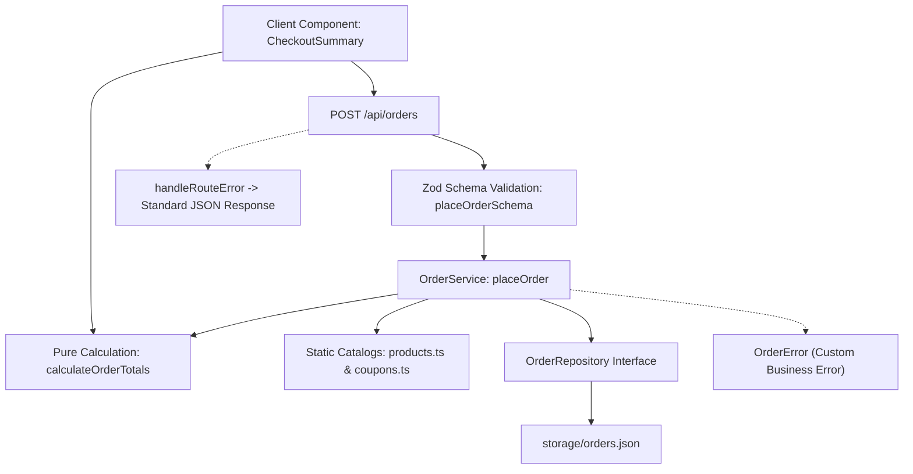

# Architecture Spine — ShopLite Coupon Feature

## Design Paradigm

ShopLite tuân thủ kiến trúc **Feature-Based Modular Architecture** kết hợp với **Repository Pattern** và **Pure Domain Calculations**:

- **Feature Co-location (`src/features/<feature>/`)**: Toàn bộ logic nghiệp vụ, schema, giao diện thành phần (components) và unit test thuộc về một năng lực được gom nhóm tại thư mục tính năng tương ứng. Thư mục `src/app/` chỉ đảm nhiệm routing và tiếp nhận HTTP request.
- **Pure Domain Calculations**: Mọi quy tắc tính toán tài chính (subtotal, shipping fee, coupon discount, total) là các hàm thuần túy (pure functions) không phụ thuộc I/O hay side-effect.
- **Repository Pattern for I/O Isolation**: Mọi thao tác đọc/ghi đơn hàng được trừu tượng hóa qua interface `OrderRepository`, cô lập hoàn toàn tầng lưu trữ JSON khỏi tầng dịch vụ nghiệp vụ (`OrderService`).



---

## Invariants & Rules

### AD-1 — Feature-Based Co-Location Architecture [ADOPTED]

- **Binds:** Toàn bộ codebase (`src/features/*`, `src/app/*`)
- **Prevents:** Logic nghiệp vụ bị phân tán rải rác trong `src/app/` hoặc tạo các thư mục dùng chung vô tội vạ.
- **Rule:** Toàn bộ mã nguồn liên quan đến coupon (types, components, test, helpers) phải đặt đồng vị trong `src/features/checkout/` (cho phía client/tính tiền) hoặc `src/features/orders/` (cho phía lưu trữ). Thư mục `src/app/` chỉ làm routing, cấm chứa logic tính toán giá hoặc truy cập dữ liệu trực tiếp.

### AD-2 — Pure Domain Functions & Test Isolation [ADOPTED]

- **Binds:** `src/features/checkout/pricing.ts`, `src/features/cart/cart-reducer.ts`
- **Prevents:** Logic tính tiền bị phụ thuộc vào môi trường runtime, DOM, I/O đĩa hoặc gây khó khăn cho việc viết unit test.
- **Rule:** Các hàm tính toán tài chính và chiết khấu coupon bắt buộc là pure functions. Hàm nhận dữ liệu đầu vào và trả về kết quả mới mà không làm đột biến tham số. Mọi trường hợp biên phải được bao phủ 100% bằng unit test chạy trên Vitest.

### AD-3 — OrderRepository Interface & Local JSON Storage [ADOPTED]

- **Binds:** `src/features/orders/order-repository.ts`, `storage/orders.json`
- **Prevents:** Tầng service bị gắn chặt vào thao tác file hệ thống, hoặc tự ý thêm external database.
- **Rule:** Mọi thao tác đọc/ghi đơn hàng bắt buộc đi qua interface `OrderRepository`. Trong môi trường runtime production sử dụng `createJsonFileOrderRepository(filePath)`. Trong môi trường test bắt buộc inject `createInMemoryOrderRepository(seed)` để kiểm thử không chạm đĩa. Không được sử dụng database bên ngoài.

### AD-4 — Server-Authoritative Price & Total Recalculation [ADOPTED]

- **Binds:** `src/features/orders/order-service.ts`, `POST /api/orders`
- **Prevents:** Lỗ hổng gian lận giá từ client (tampering), gửi sai số tiền giảm giá hoặc tổng thanh toán.
- **Rule:** Server tại `POST /api/orders` bắt buộc tính toán lại 100% đơn giá, số tiền giảm giá coupon, phí vận chuyển và tổng tiền từ các catalog thẩm quyền (`src/data/products.ts`, `src/data/coupons.ts`). Tuyệt đối bỏ qua và không tin bất kỳ số tiền nào client gửi lên trong payload.

### AD-5 — Standardized Error Hierarchy via OrderError & handleRouteError [ADOPTED]

- **Binds:** Toàn bộ route handlers và service layer
- **Prevents:** Lỗi không được xử lý làm sập server (500 crash), hoặc trả về cấu trúc JSON lỗi không đồng nhất.
- **Rule:** Nghiệp vụ ném `OrderError(code, message, details?)`. Route handlers bắt buộc bọc qua `handleRouteError(error)` để trả về định dạng JSON chuẩn `{ error: { code, message, details? } }` kèm HTTP status code tương ứng (400, 404, 409, 422).

### AD-6 — Strict Input Validation via Zod Schemas [ADOPTED]

- **Binds:** `src/features/checkout/checkout-schema.ts`, các Route Handlers
- **Prevents:** Dữ liệu đầu vào không hợp lệ hoặc thiếu trường đi sâu vào domain logic.
- **Rule:** Mọi payload gửi lên API hoặc submit qua form phải được validate qua Zod schema (`placeOrderSchema`, `checkoutFormSchema`). Lỗi validation phải được chuẩn hóa qua `toFieldErrors()`.

### AD-7 — Static Coupon Catalog & Pure Model

- **Binds:** `src/data/coupons.ts`, `FR-1`
- **Prevents:** Phức tạp hóa hệ thống bằng việc lưu coupon trong cơ sở dữ liệu động hoặc tạo nguy cơ race condition khi ghi file.
- **Rule:** Danh mục mã coupon được khai báo dưới dạng mảng hằng số in-memory tại `src/data/coupons.ts`. Cấu trúc mỗi coupon bắt buộc tuân thủ interface `Coupon`: `code` (chuỗi in hoa), `type` (`"fixed"` hoặc `"percentage"`), `value` (số nguyên dương), `maxDiscountAmount` (bắt buộc khi type là percentage), `minOrderValue` (tùy chọn), `expiryDate` (chuỗi ngày `YYYY-MM-DD`, tùy chọn).

### AD-8 — Financial Invariant & Shipping Protection Rule

- **Binds:** `src/features/checkout/pricing.ts`, `FR-3`, `FR-4`
- **Prevents:** Đơn hàng bị tổng tiền âm, số tiền giảm vượt quá tiền hàng, hoặc coupon làm thâm hụt tiền phí vận chuyển đối soát.
- **Rule:** 
  1. Số tiền giảm giá coupon (`discountAmount`) chỉ được trừ vào tạm tính (`subtotal`), không bao giờ được trừ vào phí vận chuyển (`shippingFee`).
  2. Số tiền giảm tối đa chỉ bằng tạm tính: `discountAmount <= subtotal`.
  3. Tổng tiền thanh toán: `total = subtotal - discountAmount + shippingFee >= 0`.
  4. Ngưỡng miễn phí vận chuyển (`FREE_SHIPPING_THRESHOLD = 500_000` đối với `standard`) bắt buộc được xét trên `subtotal` gốc trước khi trừ giảm giá coupon.

### AD-9 — Timezone Determinism for Expiration Check

- **Binds:** `src/features/checkout/pricing.ts`, `src/features/orders/order-service.ts`, `FR-1`, `FR-5`
- **Prevents:** Mã coupon hết hạn sớm hoặc muộn do chênh lệch múi giờ giữa máy dev local (UTC+7) và server CI/Cloud (mặc định UTC).
- **Rule:** Chuỗi `expiryDate` dạng `YYYY-MM-DD` được quy ước hết hạn vào đúng `23:59:59.999` theo giờ Việt Nam (`+07:00`). Hàm kiểm tra hết hạn phải so sánh timestamp tuyệt đối với offset UTC+7 cố định. Service hỗ trợ tham số `now?: () => Date` để inject thời gian giả lập khi chạy unit test.

### AD-10 — Order Schema Extension & Snapshot Immutability

- **Binds:** `src/features/orders/types.ts`, `storage/orders.json`, `FR-6`
- **Prevents:** Làm gãy cấu trúc đơn hàng hiện có trong `orders.json`, hoặc lịch sử đơn hàng bị thay đổi giá trị khi catalog coupon bị chỉnh sửa trong tương lai.
- **Rule:** Interface `Order` bổ sung hai trường tùy chọn: `couponCode?: string` và `discountAmount?: number`. Đơn hàng cũ không có mã vẫn hợp lệ (backward-compatible). Khi tạo đơn mới có coupon, mã và số tiền giảm được đóng băng vĩnh viễn vào đối tượng đơn hàng trong `storage/orders.json`, hoàn toàn độc lập với vòng đời của coupon trong catalog.

---

## Consistency Conventions

| Concern | Convention |
| :--- | :--- |
| Naming (files & components) | File dùng `kebab-case` (`coupon-service.ts`, `applied-coupon-pill.tsx`). React Component export tên `PascalCase`. |
| Naming (types & errors) | Interface dùng `PascalCase` (`Coupon`, `OrderTotals`). Mã lỗi dùng `UPPER_SNAKE_CASE` (`COUPON_NOT_FOUND`, `COUPON_EXPIRED`). |
| Data & formats (code) | Mã coupon luôn được chuẩn hóa `code.trim().toUpperCase()` trước khi so khớp hoặc lưu trữ. |
| Data & formats (money) | Tiền tệ lưu dạng số nguyên VNĐ (`number`), không dùng số thực (float). Hiển thị qua hàm `formatCurrency()`. |
| Data & formats (dates) | Lưu trữ đơn hàng dùng chuẩn ISO 8601 (`toISOString()`). Ngày hết hạn coupon dùng định dạng `YYYY-MM-DD`. |
| State & cross-cutting | Client Component bắt buộc khai báo `'use client'`. Server Component là mặc định. Cấm import `server.ts` vào Client Component. |

---

## Stack

| Name | Version |
| :--- | :--- |
| Next.js | 16.4.2 |
| React | 19.3.0 |
| React DOM | 19.3.0 |
| TypeScript | 5.x |
| Tailwind CSS | 4.x |
| Zod | 4.6.7 |
| Vitest | 5.0.5 |
| Playwright | 1.64.1 |
| Lucide React | 1.61.0 |
| Node.js | >=22.12.0 |

---

## Structural Seed

Cấu trúc thư mục nguồn phục vụ tính năng Coupon:

```text
src/
├── data/
│   ├── products.ts               # Catalog sản phẩm hiện có
│   └── coupons.ts                # [MỚI] Catalog mã giảm giá tĩnh (AD-7)
├── features/
│   ├── checkout/
│   │   ├── checkout-schema.ts    # [MỞ RỘNG] placeOrderSchema nhận couponCode (AD-6)
│   │   ├── pricing.ts            # [MỞ RỘNG] calculateCouponDiscount & tính lại totals (AD-2, AD-8)
│   │   ├── pricing.test.ts       # [MỞ RỘNG] Unit tests tính toán coupon (AD-2)
│   │   └── components/
│   │       ├── checkout-form.tsx # Form thanh toán chính
│   │       └── checkout-summary.tsx # [MỞ RỘNG] Ô nhập mã, hiển thị pill, dòng chiết khấu
│   └── orders/
│       ├── types.ts              # [MỞ RỘNG] Order interface thêm couponCode, discountAmount (AD-10)
│       ├── order-service.ts      # [MỞ RỘNG] Xác thực coupon và tính lại tiền phía server (AD-4, AD-9)
│       ├── order-service.test.ts # [MỞ RỘNG] Unit test kiểm thử đơn có coupon (AD-3)
│       ├── order-errors.ts       # [MỞ RỘNG] Mã lỗi coupon mới (AD-5)
│       └── order-repository.ts   # Lưu trữ đơn hàng JSON (AD-3)
storage/
└── orders.json                   # [GIỮ NGUYÊN] File lưu trữ đơn hàng cục bộ
```

---

## Capability → Architecture Map

| Capability / Yêu cầu | Nơi triển khai | Cơ chế quản trị & Ràng buộc |
| :--- | :--- | :--- |
| **FR-1: Danh mục mã tĩnh** | `src/data/coupons.ts` | AD-7 (Static catalog, Coupon interface, 3 mã mẫu) |
| **FR-2: Giao diện nhập & gỡ mã** | `src/features/checkout/components/checkout-summary.tsx` | AD-1 (Co-location), DESIGN.md, EXPERIENCE.md |
| **FR-3: Tính tiền giảm & tổng tiền** | `src/features/checkout/pricing.ts` | AD-2 (Pure functions), AD-8 (Financial Invariants) |
| **FR-4: Bảo vệ phí ship & freeship** | `src/features/checkout/pricing.ts` | AD-8 (Freeship xét trên subtotal gốc trước giảm) |
| **FR-5: Server xác thực & tính lại** | `src/features/orders/order-service.ts` | AD-4 (Server authoritative), AD-6, AD-9 (Timezone) |
| **FR-6: Snapshot coupon vào đơn** | `src/features/orders/types.ts`, `storage/orders.json` | AD-10 (Immutability snapshot, backward compatible) |
| **FR-7: Hủy đơn Chờ xác nhận** | `src/features/orders/order-service.ts` | AD-5 (`OrderError`), AGENTS.md (Giữ nguyên) |
| **FR-8: Giới hạn tồn kho** | `src/features/cart/cart-reducer.ts`, `order-service.ts` | AGENTS.md (Giữ nguyên tối đa 10 sp/loại) |

---

## Deferred

Những quyết định thiết kế được chủ động hoãn lại cho các giai đoạn phát triển sau:

- **Cơ sở dữ liệu tập trung (Database)**: Hoãn lại cho đến khi ShopLite chuyển từ cửa hàng mini sang ứng dụng thương mại đa người dùng thực tế có yêu cầu khóa đồng thời (concurrency lock).
- **Hệ thống Quản trị Khuyến mãi (Admin Portal)**: Hoãn lại; hiện tại việc thêm/bớt mã thực hiện qua Git commit trên file `src/data/coupons.ts` nhằm giữ nguyên lý đơn giản không nợ hạ tầng.
- **Gắn mã theo người dùng & Giới hạn số lượt dùng**: Hoãn lại cho đến khi hệ thống triển khai module Xác thực tài khoản (User Authentication).
- **Áp dụng nhiều mã đồng thời (Coupon Stacking)**: Hoãn lại vì làm tăng độ phức tạp của bài toán thứ tự ưu tiên chiết khấu và rủi ro xói mòn biên lợi nhuận.
